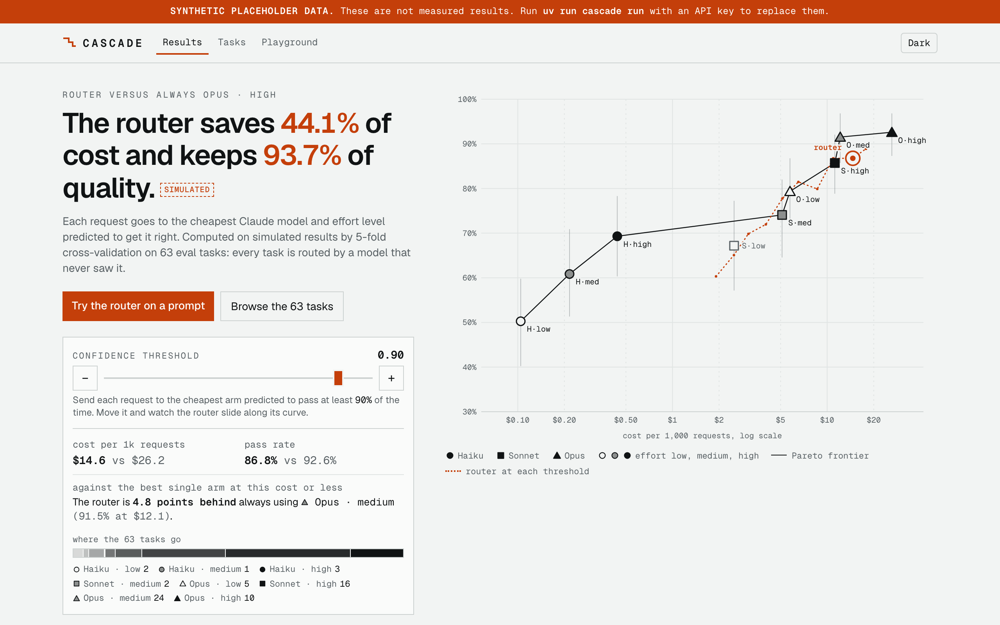
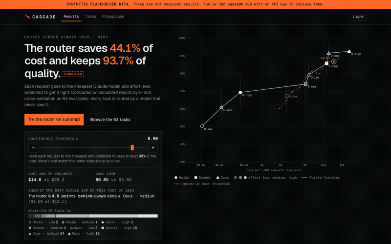
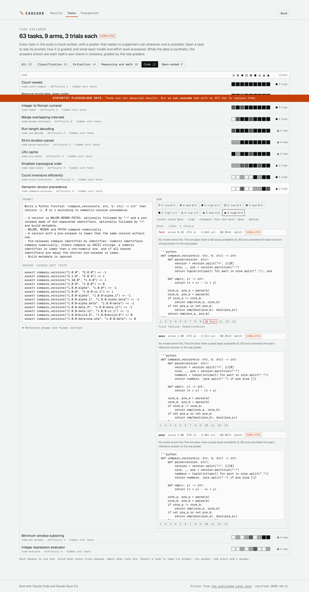
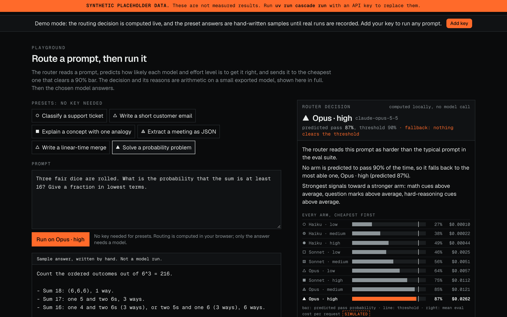
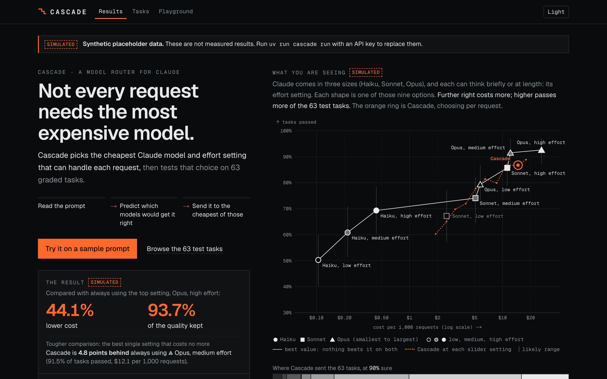
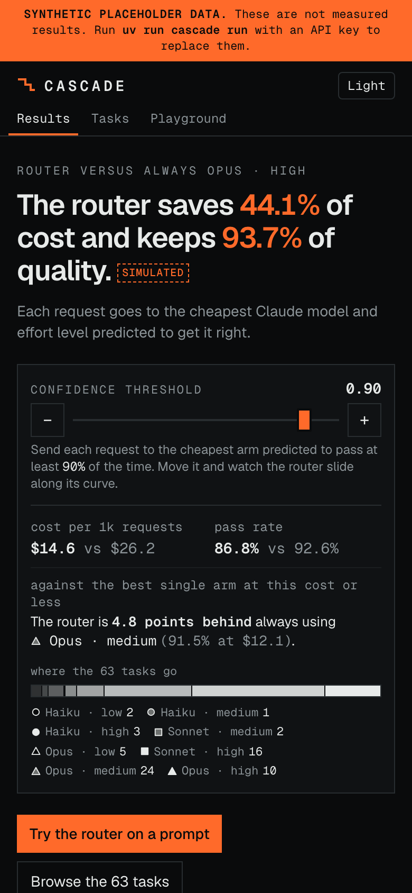

# Cascade

Not every request needs the most expensive AI model. Cascade picks the cheapest Claude model and effort setting that can handle each request, and tests that choice on 63 graded tasks.

[](https://github.com/davezagin-max/cascade/actions/workflows/ci.yml)
[](LICENSE)
[](#run-locally)



*The first screen. Each shape on the chart is one Claude model at one effort setting: further right costs more, higher passes more tasks. The orange ring is Cascade, and the slider on the left moves it. The numbers are simulated and labelled as such (see below).*

## What it does

- **Picks a model for each request.** Claude comes in three sizes (Haiku, Sonnet, Opus), and each can think briefly or at length (its effort setting). Cascade reads a prompt and sends it to the cheapest option predicted to get it right, so easy requests stop paying for the biggest model.
- **Explains every choice.** The playground shows which model it picked, how likely each option was to succeed, and which clues in the prompt pushed the decision. The choice is plain arithmetic that runs in your browser.
- **Tests itself.** 63 hand-written tasks (classifying, pulling data out of text, math, code, writing) are graded automatically, and the dashboard compares Cascade with simply always using one model, including the best single model it could afford instead.
- **Is honest about its data.** No paid run has been made yet, so the dashboard's numbers come from a clearly labelled simulator. One command replaces them with a real run.

> **Synthetic placeholder data. These are not measured results. Run `uv run cascade run` with an API key to replace them.**
> In plain words: no real test run exists in this commit. Every number in the screenshots comes from a labelled, deterministic simulator, and the app tags each one "simulated".

## Try it

The live demo is coming soon. Here is the one-click tour: the slider trades cost for quality, then **Try it on a sample prompt** sends a sample support ticket through Cascade, shows which model it picks and why, and plays the answer.



To run it yourself with no key (details in [Run locally](#run-locally)):

```bash
pnpm install
pnpm dev        # then open http://localhost:3150
```

The playground's answers in this commit are hand-written examples; `pnpm record` replaces them with real runs of whichever Claude model Cascade picks. The model choice itself is never canned: it is computed in your browser for any text you type. Add your own Anthropic key in the app to get any prompt answered live.

## Why it's interesting

For engineers. Vocabulary: an *arm* is one model at one effort setting (Opus at high effort, say; there are nine), the *threshold* is how sure the router must be before it picks a cheaper arm, and the *Pareto frontier* is the set of arms that no other arm beats on both cost and quality.

- **The router has to beat a harder baseline than "always Opus".** Any cheaper arm saves money against Opus at high effort, so that headline is easy to win. Every threshold is also compared with the strongest single arm that costs no more than the router does there, and that sentence sits next to the headline. On the sample data the router loses that comparison at the default threshold, and the page says so instead of hiding it. The penalty on the router's weights is chosen by nested cross-validation, so when the prompt features carry no signal it shrinks toward "one arm for everything" instead of routing on noise.
- **One router, two languages, bit-identical.** The router is trained in Python (numpy logistic regression) and served in TypeScript, in the API route and in the browser. Features are defined once in a JSON spec that both sides interpret. Every feature value is an integer count through one addition and one division, and routing compares logits against a precomputed threshold, so there is no `log` or `exp` on the serving path whose last bit could differ. 80 exported vectors (every task prompt plus emoji, CRLF, CJK and a 5,000-character string) are checked for exact equality by both test suites.
- **Placeholder data that cannot pass for a measurement.** With no API key there is no real run, so `cascade simulate` writes one in exactly the real schema with `synthetic: true`. The notice, every "simulated" tag, and the words "measured" and "simulated" all follow that one flag, and a test renders the dashboard in both states. A full run was also made with a fake API client and exported into the repo to prove the same dashboard shows a real run with no code change, then reverted.

## Results

**Synthetic placeholder data. These are not measured results. Run `uv run cascade run` with an API key to replace them.**

The table below is what the simulator produced (seed 7): pass or fail is drawn from assumed model abilities and task difficulties, token counts and latencies are stated assumptions, and only the grading is real (the stand-in answers go through the real graders, except open-ended tasks, whose rubric scores are drawn because the judge needs a key). It shows the shape of the output, not how Claude models perform.

| Simulated, not measured | Value |
| --- | --- |
| Matrix | 63 tasks x 9 arms (Haiku, Sonnet, Opus x low, medium, high) x 3 trials = 1,701 rows |
| Router at threshold 0.90 versus always Opus at high effort | 44.1% of cost saved, 93.7% of quality retained |
| Same router versus the best single arm at that cost or less | 4.8 points behind always Opus at medium effort |
| Thresholds at which the router is ahead of the best affordable arm | 6 of 10 |
| Held-out log loss with prompt features, and with arm abilities alone | 0.496 and 0.528 |
| Prompt caching, 10 calls over a 1,480-token prefix | 55.7% of the bill saved, ahead from call 2 |

The dashboard also shows the Pareto frontier with 95% bootstrap intervals, a per-category breakdown, p50 and p95 latency, cost per 1,000 requests at list and batch price, the confusion matrix between the router's pick and the best arm in hindsight, and a task explorer with every arm's answer and grade.

| Task explorer | Playground |
| --- | --- |
|  |  |

| Dark | Phone |
| --- | --- |
|  |  |

## Architecture

```mermaid
flowchart LR
  subgraph Lab["evals/ (Python, runs offline)"]
    Tasks["63 tasks in TOML"] --> Plan["Plan: task x arm x trial"]
    Plan -->|"Message Batches API, half price"| Models[("Haiku, Sonnet, Opus 5.5")]
    Plan -->|"timed synchronous sample"| Models
    Plan -.->|"no key"| Sim["Simulator, flagged synthetic"]
    Models --> Rows[("results.parquet")]
    Sim --> Rows
    Rows --> Grade["Graders: exact, JSON Schema, sandboxed tests, Opus judge"]
    Grade --> Train["Router trainer: logistic regression, nested CV"]
    Train --> Export["cascade export"]
  end
  Export --> Data["JSON in data/ and public/run/tasks/"]
  subgraph Web["Next.js (one Vercel deploy)"]
    Data --> Dash["Static dashboard and task explorer"]
    Data --> Router["Router in TypeScript, parity-tested"]
    Router --> UI["Playground: decision computed in the browser"]
    UI -->|"POST /api/route-and-run with x-anthropic-key"| API["API route"]
    API -->|"no key"| Fixtures[("Preset fixtures")]
    API -->|"key"| Answer["The chosen model at the chosen effort"]
  end
```



The Python lab never runs on the server. It writes JSON that the Next.js app bundles, so the deployed site is static pages plus one route handler, and `evals/` is excluded from the deploy.

## How it uses Claude Opus 5.5

| Feature | Why |
| --- | --- |
| Effort sweep (`low`, `medium`, `high`; flags add `xhigh` and `max`) on all three models | Thinking is always on, so effort is the depth and cost control. The eval measures what each step up buys, per task type. |
| Message Batches API with `custom_id` | 1,611 of the 1,701 eval requests go out at half price. Results are matched by id, never by position, and batch ids are saved so an interrupted run resumes. |
| Multi-model routing | The router picks one of nine (model, effort) arms per prompt. The playground then calls exactly that model at that effort and shows tokens, cost, and an estimate of the same request on Opus at high effort. |
| Opus as a blind judge with structured output | Open-ended tasks are scored 0 to 2 per rubric criterion. The judge never sees which model answered, the answer is wrapped as untrusted data, and the weighted total is computed in code. The schema cannot express the 0 to 2 range, so it is validated after parsing with one retry. |
| Prompt caching experiment | The same 1,480-token prefix, 10 calls, with and without a cache breakpoint, plus a prefix under the 512-token minimum that is silently not cached. Reports cache-write and cache-read tokens, the dollar difference, and the 5-minute lifetime. |
| Refusals as results | In the eval a refusal scores zero and the refusal fallback is off, so the arm under test is the model that answered. In the playground a refusal reaches the visitor as a plain "declined" message with what it cost. |
| Adaptive thinking, explicit effort, no forced tool choice | Every call goes through one helper per language (`lib/claude.ts`, `evals/cascade/claude_client.py`) that encodes these rules, selects content by block type, and prices usage from one table. |
| Streaming with cancellation | The playground streams the answer. Stop, a new run, or leaving the page aborts the request, and with it the model call. |

**Your key stays yours.** The app is bring-your-own-key. The key lives in your browser tab's memory (optionally `sessionStorage`), travels in an `x-anthropic-key` header to this app's own API route, and is used for that one request. The server never stores or logs it. Each live action shows its token count and cost.

## Run locally

```bash
pnpm install
pnpm dev
```

Open http://localhost:3150. It runs in demo mode until you add a key in the UI.

### The eval lab

The lab needs Python 3.12 and [uv](https://docs.astral.sh/uv/). Everything except `run` works with no key.

```bash
cd evals
uv run cascade tasks --validate   # list the suite; check every reference passes and every known-wrong answer fails
uv run cascade estimate           # tokens and dollars for the matrix, before anything is sent
uv run cascade simulate           # rewrite the labelled synthetic run and the dashboard data
uv run cascade run                # the real matrix: needs ANTHROPIC_API_KEY, about $9.43 estimated
```

`run` prints the estimate, asks before spending more than $5, refuses to start above `--budget` (default $12), and stops between model tiers if measured spend projects past the budget. It then grades, trains the router, and exports, so the dashboard shows the real run with no code change. Other commands: `grade`, `train-router`, `caching`, `export`. Results are one Parquet row per task, model, effort and trial in `evals/runs/<run-id>/`.

After a real run, `pnpm record` replaces the six hand-written playground answers with recorded ones. It starts its own dev server on port 3150, so stop `pnpm dev` first.

## Tests & quality

```bash
pnpm check                                    # lint, typecheck, unit tests, production build
cd evals && uv run ruff check . && uv run mypy && uv run pytest -q
```

224 tests pass: 95 in Vitest and 129 in pytest. Four more are live smoke tests that are skipped when no key is set.

- **Graders are tested against the suite itself.** For all 57 deterministic tasks the reference answer must score full marks and a hand-written plausible mistake must fail, which catches a wrong answer key, a bad hidden test, and a grader that is too lenient.
- **Parity.** Both suites assert exact equality with the 80 exported router vectors.
- **The runner, with a fake API client.** Batch results returned in reverse order, failed, expired and missing items, refusals, truncation, resume, the budget gate, and an interrupted run that must stop sending.
- **Honesty.** The dashboard is rendered synthetic and real, and every fixture is checked against its own placeholder flag, so the tests keep passing once real data is recorded.
- **Demo-mode smoke test** of the playground route, plus `pnpm interactions` and `pnpm overflow` (headless Chromium: Stop sends nothing further, the main button plays a sample with one request, no sideways scroll at 360 and 390 px).
- **Functional pass** (`pnpm functional`) checks every visitor-facing control against a production build on port 3150 (`pnpm build`, then `pnpm exec next start -p 3150`): the threshold moves the headline and chart, every task opens with its tries, each preset routes and answers, Stop and replacement behave, the key dialog validates, the API route's error paths return their documented statuses, and nothing scrolls sideways at 360 or 390 px. It makes no call to Claude: a guard aborts any request that leaves the app.

CI runs the same checks plus a gitleaks secret scan on every push.

## Tradeoffs, limitations, next steps

- **Nothing here has been measured yet.** No API call has been made. The batch, judge, caching and live playground paths are exercised with fake clients only, and the first real run is the first real test of them.
- **The code grader is not a hardened sandbox.** Model-written Python runs in a subprocess with a timeout, an empty temp directory, an environment with no secrets, and self-applied resource limits. It still runs as the current user with network and filesystem access. A production grader would run each answer in a container or microVM with no network, a read-only root, a seccomp filter and a throwaway user: gVisor, Firecracker, nsjail, or a hosted code-execution sandbox.
- **63 tasks is a small suite.** It is enough to separate tiers and too few to trust a single percentage point. Intervals are bootstrapped over tasks, and latency percentiles come from 10 timed requests per arm.
- **The router sees text features only.** It is a logistic regression on 18 cheap counts with one weight vector shared across arms. A Haiku pre-pass that reads the prompt would likely predict difficulty better at a small cost per request; it was not built.
- **The 0.90 default threshold was fixed before any data** and has not been tuned. On the sample data a lower threshold does better.
- **After a real run and before `pnpm record`,** the playground shows the retrained router's decision beside a sample answer written for the old routing. It stays labelled as a sample.
- Rate limiting is in memory per server instance: enough to blunt abuse of a demo, not a global quota.

Next steps: run the real matrix, a Haiku pre-pass router as a second policy on the same chart, `xhigh` and `max` in the default matrix, a Playwright job in CI, and a larger suite.

---

Built with Claude Code and Claude Opus 5.5.
